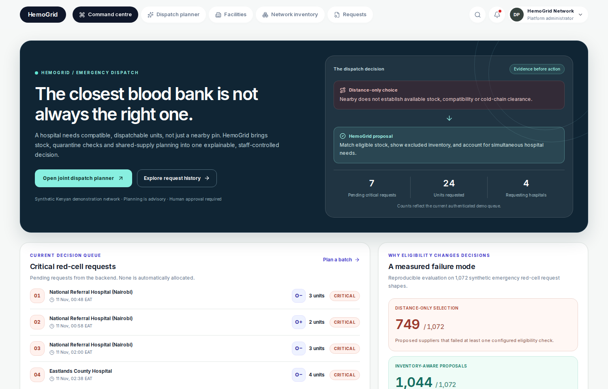

# HemoGrid

### The closest blood bank is not always the right one.

**🏆 Overall First Place · Terumo BCT Africa Hackathon 2026**

**Emergency blood request and dispatch · Team Relay**

**[Launch the live demo](https://hemogrid-eight.vercel.app/login)** · **[Demo video](https://www.tella.tv/video/hemogrid-emergency-blood-dispatch-dt1odmiq)** · **[Pitch slides](https://docs.google.com/presentation/d/1E3NaYlyrvygwXysVymFKq4qBNCi22wb428WnZNdBTfE/edit)**

**[Frontend code](frontend/)** · **[Backend and evaluation](backend/)** · **[Judges' quick guide](frontend/docs/JUDGE_START_HERE.md)**

**No registration required for the synthetic demonstration.** Select Hospital, Blood bank or Platform admin. Demonstration credentials are prefilled; do not enter personal credentials.

Screenshot from the synthetic demonstration, not a live clinical system.

---

## One project, one repository

HemoGrid is a collaborative **Team Relay** emergency blood-dispatch prototype. The original submission used two connected GitHub repositories. This personal monorepo brings the frontend and backend together while preserving their Git histories and the original team attribution.

| Directory | Contents |
| --- | --- |
| **[frontend/](frontend/)** | Next.js, React and TypeScript application, staff-facing workflows, demonstration guide, browser checks |
| **[backend/](backend/)** | Spring Boot and PostgreSQL API, inventory reservations, quarantine checks, advisory joint planning, automated tests and reproducible evaluations |

**Original Team Relay sources:** [frontend](https://github.com/Team-Relay/hemo-grid-frontend) · [backend](https://github.com/Team-Relay/hemo-grid-backend).

## How HemoGrid works

A hospital officer creates a request and reviews candidate suppliers using recorded stock, configured blood-group rules, quarantine status and estimated routes. A network coordinator can compare advisory allocations for **2–5** urgent red-cell requests that share limited inventory. The supplying blood bank then independently accepts, reserves and fulfils a request. Human approval and clinical verification remain necessary.

**Operational safeguards:** server-side eligibility revalidation, organization-scoped authorization, transactional reservation and concurrency checks, and a tested individual-dispatch fallback when the joint planner fails.

## Evaluated evidence and limitations

In a controlled **synthetic** benchmark of 1,072 red-cell requests, choosing the nearest active site failed one or more configured eligibility checks for 749 requests. HemoGrid and the nearest-eligible baseline each produced eligible full-quantity recommendations for 1,044 of 1,072 requests. In one scarcity scenario involving five-request batches, HemoGrid completed 150 of 214 batches compared with 146 of 214 for sequential nearest-eligible selection.

These are software tests on synthetic data, **not** clinical accuracy measurements, real transport times, or patient outcomes. The joint planner is deterministic and advisory. Blood group compatibility, clinical crossmatching, real inventory feeds and actual operations need independent verification before clinical use.

[Evaluation methods, datasets, baselines and limitations](backend/README.md#ai-and-data) · [Original hosted synthetic transaction test](https://github.com/Team-Relay/hemo-grid-frontend/actions/runs/42952475072)

## Contributors and responsibilities

| Contributor | Contribution |
| --- | --- |
| **Grold Otieno** | **Technical lead**: system architecture, frontend and backend engineering, dispatch planning, inventory and concurrency safeguards, integration, automated testing and reproducible evaluation |
| **Dennis Ikechukwu Okwuchukwu** | Original HemoGrid idea and concept |
| **Mubarak Zubair** | Product input and clinical-data analysis |

This unified repository preserves the contributors' roles and original Git commit histories while recognizing HemoGrid as a Team Relay collaboration.

## Running the prototype

See the [frontend setup](frontend/README.md) and [backend setup](backend/README.md) for requirements, commands and documented limitations. The two applications remain separate services within this single source repository; no deployment or CI migration is implied by the consolidation.

Built for a hackathon using synthetic Kenyan network data. Not for clinical use. No real patient data, certified interoperability, measured deliveries or clinical outcome claims.
